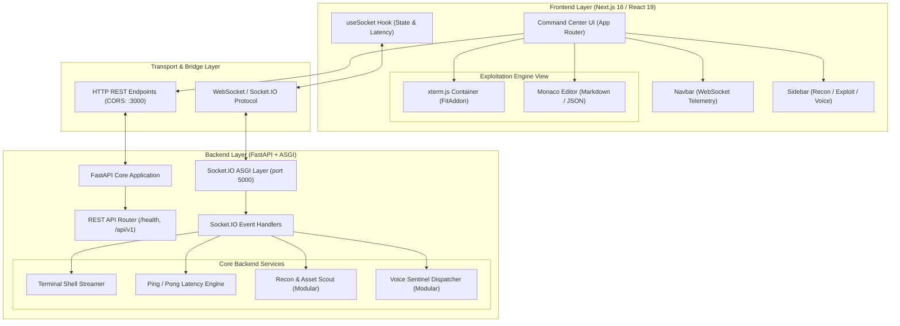
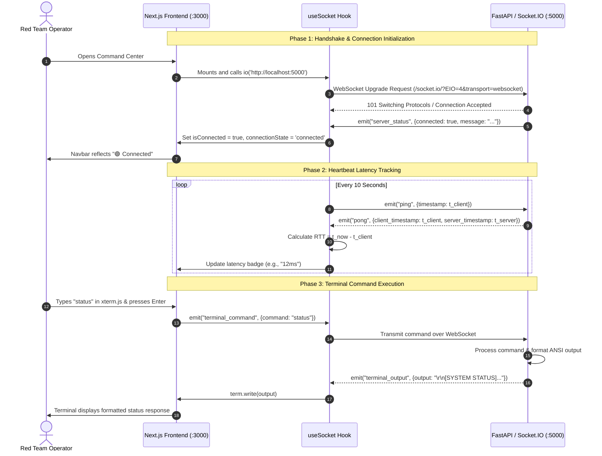

# Cyber-Cerberus: Systems Architecture & Technical Blueprint

## 1. System Overview

**Cyber-Cerberus** is a locally-hosted, multi-modal Red Team Operations Suite designed to augment and accelerate offensive cyber operations. Built to meet the requirements of modern penetration testers, security researchers, and adversary simulation teams, Cyber-Cerberus unifies live streaming terminal execution, real-time vulnerability report synthesis, autonomous reconnaissance, and hands-free voice operations under a centralized, dark-mode command center.

The platform employs a decoupled **Client-Server Architecture** utilizing:
- **Frontend Presentation Layer**: Next.js 16 (React 19, TypeScript, Tailwind CSS, App Router) running on `http://localhost:3000`.
- **Backend Service & C2 Bridge**: Python 3.12+ (FastAPI, Starlette ASGI, Python-SocketIO) running on `http://localhost:5000`.
- **Real-Time Streaming Bridge**: Socket.IO over ASGI/WebSockets with automatic fallback to long-polling and sub-millisecond event delivery.
- **Embedded Interactive Subsystems**:
  - `xterm.js` with `xterm-addon-fit` for bidirectional command execution and real-time streaming.
  - `@monaco-editor/react` for vulnerability reporting and JSON/Markdown payload authoring.

---

## 2. Component Architecture Breakdown

### 2.1 Frontend Presentation Tier (`/frontend`)

The frontend is constructed using Next.js 16 utilizing the App Router architecture, with strict client-side boundaries (`'use client'`) for browser-only DOM libraries.

1. **State & Connection Management (`src/hooks/useSocket.ts`)**:
   - Manages the lifecycle of the Socket.IO client instance.
   - Monitors connection states: `connected`, `connecting`, and `disconnected`.
   - Executes periodic heartbeat pings (every 10 seconds) measuring round-trip time (RTT in milliseconds).
   - Provides clean unmount and automatic reconnection logic.

2. **Command Center Navigation (`src/components/layout/Navbar.tsx` & `Sidebar.tsx`)**:
   - **Navbar**: Displays suite branding, active operational module, target scope, manual ping diagnostics, and a dynamic status badge (`🟢 Connected (Xms)` / `🔴 Disconnected`).
   - **Sidebar**: Provides tab navigation across three core operational operational paradigms:
     - 🔍 **Target Recon**: Attack surface mapping, exposed port census, and asset identification.
     - 🎯 **Exploitation Engine**: Live split-screen execution console and report authoring.
     - 🎙️ **Voice Sentinel**: Voice command recognition, acoustic spectrogram, and hotword dispatch.

3. **Live Streaming Terminal (`src/components/terminal/XTerminal.tsx`)**:
   - Integrates `xterm.js` wrapped in a dynamic container with responsive resizing managed via `xterm-addon-fit`.
   - Implements custom cyberpunk Dracula/Monokai color themes with cursor blinking and customized ANSI palette.
   - Handles keystrokes interactively, echoes output locally or dispatches commands to the backend via `terminal_command` WebSocket events.
   - Provides quick action controls: Buffer Clear, Session Reset, and Stream Synchronization indicators.

4. **Vulnerability Report Viewer & Editor (`src/components/editor/VulnerabilityEditor.tsx`)**:
   - Integrates `@monaco-editor/react` with SSR hydration safeguards.
   - Dual-mode support:
     - **Markdown Mode**: Pre-loaded with comprehensive executive vulnerability assessment templates (executive summary, CVSS scoring, PoC reproduction, remediation advice).
     - **JSON Mode**: Pre-loaded with structured target telemetry manifests and exploit configuration payloads.
   - Toolbar features: Format switching, clipboard export, and direct local report downloading.

---

### 2.2 Backend Service Tier (`/backend`)

The backend is developed in Python 3.12+ and serves as the operational engine, command dispatcher, and asynchronous bridge.

1. **ASGI Application Architecture (`main.py`)**:
   - Utilizes `python-socketio.AsyncServer(async_mode='asgi')` combined with `FastAPI` using `socketio.ASGIApp`.
   - Socket.IO intercepts `/socket.io/` requests, while passing all standard HTTP routes directly to FastAPI.
   - Configured with Cross-Origin Resource Sharing (CORS) explicitly allowing origins `http://localhost:3000` and `http://127.0.0.1:3000`.

2. **Event Dispatching & Communication Protocols**:
   - `connect`: Handles client handshake, allocates Session ID (`sid`), and transmits server readiness telemetry.
   - `disconnect`: Safely cleans up client session tracking.
   - `ping`: Accepts client timestamps and returns an immediate `pong` payload containing the original timestamp and server epoch for high-precision latency profiling.
   - `terminal_command`: Handles interactive shell execution, simulated tool dispatch (`help`, `status`, `recon`, `clear`), and streams outputs back to the active terminal.

3. **REST Endpoints**:
   - `GET /health`: Returns service health status, operating mode, and timestamp.
   - `GET /`: Root metadata endpoint exposing active suite capabilities and WebSocket ingress paths.

---

## 3. Communication & Data Flow Sequence

The diagram below details the sequence of initialization, heartbeat latency calculation, and terminal command execution between the Next.js frontend and the FastAPI backend:

---

## 4. Security & Isolation Architecture

Because Cyber-Cerberus is built as an offensive operations suite, strict local isolation standards are applied:

1. **Local-Only Bindings**:
   - Development servers are bound to localhost (`127.0.0.1` / `0.0.0.0` for local bridge testing) to prevent unintended external exposure.
2. **CORS Isolation**:
   - FastAPI and Socket.IO servers restrict origins to the Next.js frontend origin, preventing Cross-Site WebSocket Hijacking (CSWSH) from malicious external web pages.
3. **Safe Client Hydration**:
   - Terminal and editor components check for browser window availability before binding to avoid SSR code execution leaks.
4. **Air-Gap Capability**:
   - The suite is designed to function entirely offline in air-gapped lab ranges without requiring external third-party cloud API dependencies for basic terminal and report functionality.

---

## 5. Technology Stack Summary

| Layer | Technology | Version | Purpose |
| :--- | :--- | :--- | :--- |
| **Frontend Framework** | Next.js (App Router) | 16.3.8 | Core single-page command center application |
| **Language (UI)** | TypeScript | 5.x | Type safety, component contracts, and interfaces |
| **Styling & Theme** | Tailwind CSS | 4.x | Dark cyber-aesthetic, responsive grids, utilities |
| **Terminal Emulator** | `xterm` & `xterm-addon-fit` | 5.3.0 / 0.8.0 | High-performance canvas/DOM shell emulator |
| **Code / Report Editor** | `@monaco-editor/react` | 4.7.0 | VS Code editor for Markdown reports & JSON manifests |
| **Icons & UI Accents** | `lucide-react` | 1.16.0 | Vector cyber iconography and status badges |
| **Backend Framework** | FastAPI | 0.142.2 | High-performance Python async REST API |
| **ASGI Web Server** | Uvicorn (standard) | 0.54.0 | Asynchronous server implementation |
| **Real-time Protocol** | `python-socketio` / `socket.io-client` | 5.17.0 / 4.8.1 | Bidirectional streaming and event transport |
| **Runtime Environment** | Python 3.12 / Node.js 22 | Latest LTS | Cross-platform local runtime environment |
