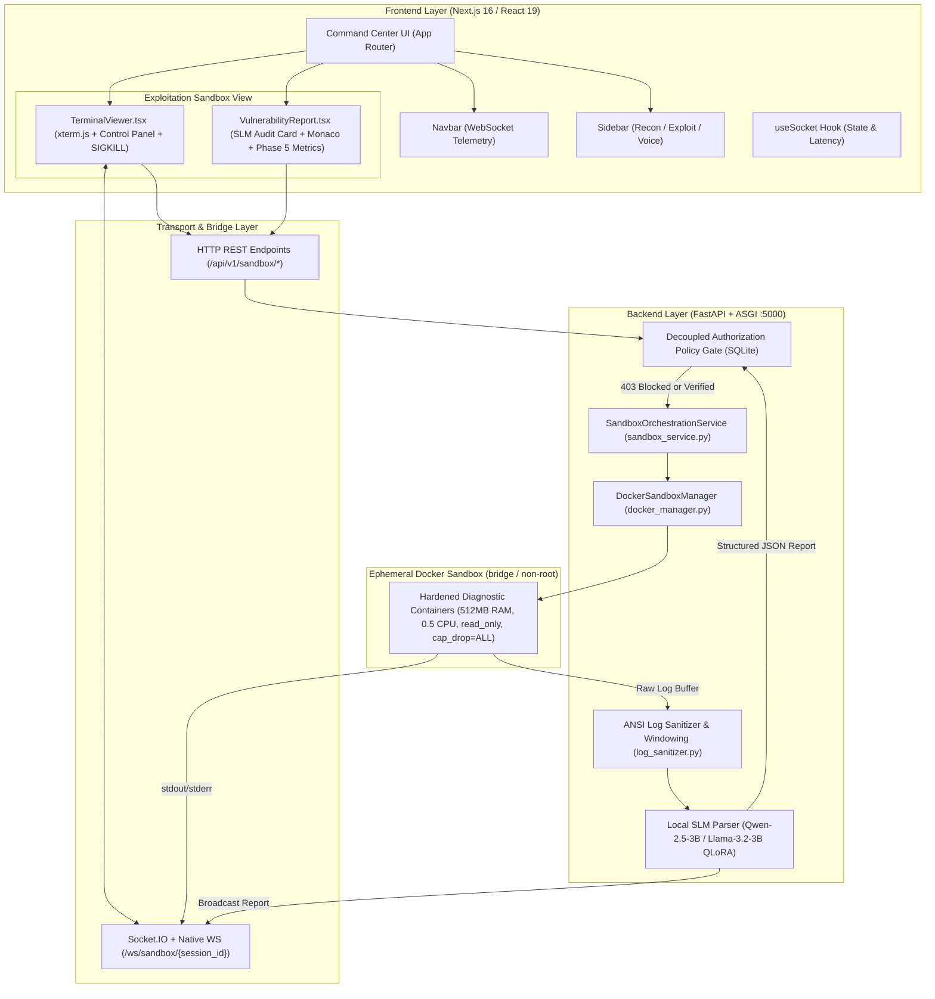

# Cyber-Cerberus (RedShield): Systems Architecture & Technical Blueprint

## 1. System Overview

**Cyber-Cerberus** (incorporating the **RedShield Exploitation Sandbox & Security Log Parsing (SLM)** engine) is a locally-hosted, multi-modal Red Team Operations Suite and controlled security verification platform. It bridges the gap between running isolated diagnostic tools and obtaining auditable, structured vulnerability intelligence—without giving autonomous decision-making power to an AI.

The platform employs a decoupled **Client-Server & Ephemeral Sandbox Architecture** utilizing:
- **Frontend Presentation Layer**: Next.js 16 (React 19, TypeScript, Tailwind CSS, App Router) running on `http://localhost:3000`.
- **Backend Service, Policy Gate & Sandbox Controller**: Python 3.12+ (FastAPI, Starlette ASGI, `python-socketio`, `docker-py`, SQLite) running on `http://localhost:5000`.
- **Decoupled Authorization Policy Gate (`backend/app/core/policy_gate.py`)**: Blocks unverified, internal metadata (`169.254.169.254`), or unauthorized external targets with `403 Target Blocked` before any container is provisioned.
- **Hardened Ephemeral Containers (`docker/tools/{sqlmap,xsstrike,ffuf}`)**: Non-root (`sandboxuser`), read-only root filesystem (`read_only=True`), dropped Linux capabilities (`cap_drop=["ALL"]`), `no-new-privileges:true`, `mem_limit="512m"`, and `cpu_quota=50000` (0.5 CPU).
- **Real-Time Dual Multiplexing Bridge**: Native WebSocket (`/ws/sandbox/{session_id}`) + Socket.IO over ASGI streaming raw `stdout`/`stderr` chunks to `xterm.js` while accumulating an in-memory buffer for post-execution analysis.
- **Local SLM Evidence Extraction Engine (`backend/app/services/slm_engine.py` & `slm_parser.py`)**: Sanitizes ANSI escape sequences (`log_sanitizer.py`), applies a constrained zero-hallucination prompt to a local Small Language Model (`Qwen/Qwen2.5-3B-Instruct` or `meta-llama/Llama-3.2-3B-Instruct` fine-tuned via 4-bit QLoRA `r=16, alpha=32`), and outputs a validated `SLMVulnerabilityReport` JSON mapped to CVE, CWE, and MITRE ATT&CK.

---

## 2. Component Architecture Breakdown

### 2.1 Frontend Presentation Tier (`/frontend`)

1. **Command Center Layout & Navigation (`src/app/page.tsx`, `src/components/layout/Navbar.tsx`, `src/components/layout/Sidebar.tsx`)**:
   - Keeps all three operational modules (`exploit`, `recon`, `voice`) mounted using visibility toggling so terminal sessions and report drafts persist across module switches without creating duplicate WebSocket connections.
   - Features a collapsible desktop sidebar (`w-64` to `w-16` icon rail) and a responsive mobile navigation drawer (`role="dialog"`), with live Host Telemetry (`ONLINE` / `CONNECTING` / `OFFLINE`) bound directly to the `useSocket` connection state.

2. **Sandbox Terminal & Execution Control Panel (`src/components/TerminalViewer.tsx` & `src/components/terminal/XTerminal.tsx`)**:
   - Mounts `xterm.js` and `xterm-addon-fit` dynamically (`'use client'`), using a `ResizeObserver` and visibility refit hook so terminal dimensions automatically adjust when the sidebar collapses/expands or when returning from another tab.
   - Provides the **Execution Control Panel**:
     - Target Scope Preset Picker & URL input (`http://juice-shop.local`, `http://dvwa.local`, or unauthorized metadata test case).
     - Diagnostic Module Selector (`sqlmap` SQLi Audit, `xsstrike` XSS Audit, `ffuf` SSRF/Surface Audit).
     - Scan Profile selector (`vulnerable` vs `benign`).
     - **LAUNCH SANDBOX** (`POST /api/v1/sandbox/launch`) and **KILLSWITCH (SIGKILL)** (`POST /api/v1/sandbox/{session_id}/kill`).
   - Connects directly to `/ws/sandbox/{session_id}` to stream real-time container logs into `xterm.js`.

3. **Structured Vulnerability Report Viewer & Editor (`src/components/VulnerabilityReport.tsx` & `src/components/editor/VulnerabilityEditor.tsx`)**:
   - Renders the SLM's `SLMVulnerabilityReport` output:
     - Severity Badge (`Critical`, `High`, `Medium`, `Low`, `Benign`).
     - SLM Confidence Score meter (`0% - 100%`).
     - CWE (`CWE-89`, `CWE-79`, `CWE-918`), CVE, and MITRE ATT&CK (`T1190`, `T1059.007`) tags with one-click accessible copy buttons.
     - Confirmed diagnostic evidence payload & affected parameter.
     - View switcher across **AUDIT CARD**, **MARKDOWN**, **JSON (MONACO)**, and **PHASE 5 METRICS** live benchmark runner, preserving Markdown and JSON edits independently with explicit confirmation before resetting modified templates.

---

### 2.2 Backend Service & Sandbox Tier (`/backend`)

1. **Decoupled Authorization Policy Gate (`app/core/policy_gate.py`)**:
   - Backed by SQLite (`backend/sandbox_audit.db`).
   - Verifies that `target_url` matches an active authorized scope (`DEFAULT_AUTHORIZED_TARGETS`) and immediately blocks forbidden cloud metadata (`169.254.169.254`), internal RFC1918 routers (`10.0.0.1`), or unverified external domains with HTTP `403 Target Blocked`.
   - Persists completed `SLMVulnerabilityReport` records for compliance auditing.

2. **Docker Sandbox Manager (`app/services/docker_manager.py` & `sandbox_service.py`)**:
   - Enforces `CONTAINER_SECURITY_BASELINE`:
     - `mem_limit="512m"`, `cpu_quota=50000` (0.5 CPU), `network_mode="bridge"`, `cap_drop=["ALL"]`, `read_only=True`, `security_opt=["no-new-privileges:true"]`.
   - Enforces hard execution timeouts (`60s` default) and supports immediate operator `SIGKILL` teardown (`kill_session()`).

3. **Log Sanitizer & Local SLM Parser (`app/services/log_sanitizer.py`, `slm_parser.py`, `slm_engine.py`)**:
   - Strips ANSI escape codes (`\x1B(?:[@-Z\\-_]|\[[0-?]*[ -/]*[@-~])`), control bytes, and progress bars, windowing the buffer to fit the context boundary.
   - Formats the sanitized log into the Constrained SLM Parser Prompt Template and extracts a zero-hallucination `SLMVulnerabilityReport`.

4. **LoRA / QLoRA Fine-Tuning Pipeline (`/training`)**:
   - `training/prepare_dataset.py`: Generates 300 ground-truth labeled SFT examples in `training/datasets/security_logs_sft.jsonl`.
   - `training/fine_tune_lora.py` & `training/train_lora.py`: Fine-tunes `Qwen/Qwen2.5-3B-Instruct` or `meta-llama/Llama-3.2-3B-Instruct` using `peft` (`r=16, lora_alpha=32`) and `trl` (`SFTTrainer`) with 4-bit `BitsAndBytesConfig`.
   - `training/export_model.py`: Merges LoRA adapters into base weights for standalone deployment.

5. **REST & WebSocket Endpoints (`app/api/v1/endpoints/sandbox.py`)**:
   - `POST /api/v1/sandbox/launch`: Policy Gate verification + ephemeral container launch.
   - `POST /api/v1/sandbox/{session_id}/kill`: Immediate `SIGKILL` container teardown.
   - `GET /api/v1/sandbox/reports`: Retrieve historical SLM structured JSON reports.
   - `GET /api/v1/sandbox/policy/targets` & `POST /api/v1/sandbox/policy/authorize`: Manage Policy Gate target scopes.
   - `POST /api/v1/sandbox/parse-log`: Direct log sanitization + SLM JSON extraction.
   - `POST /api/v1/sandbox/benchmark`: Execute Phase 5 latency, egress policy, and 50+50 hallucination verification benchmarks.
   - `WS /ws/sandbox/{session_id}`: Real-time bidirectional container log streamer.
