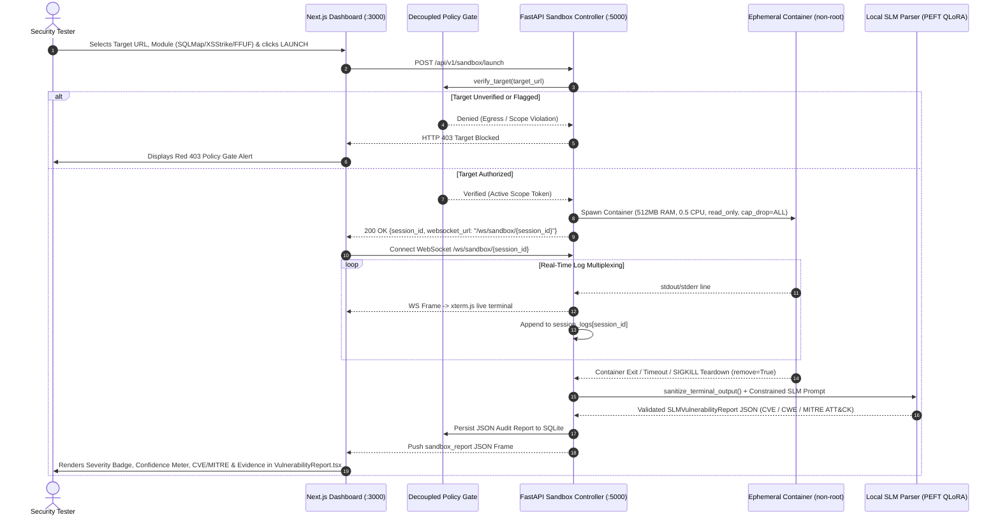

# Red-Shield: Operator User Flow & Interaction Journey

## 1. Overview

This document outlines the operational lifecycle, end-to-end user journeys, and state transitions of an operator using **Red-Shield** and its **Exploitation Sandbox & Local SLM Log Parser**.

---

## 2. End-to-End Sandbox & SLM Execution Journey

---

## 3. Step-by-Step Operator User Flows

### Flow 1: Launching an Authorized Sandbox Scan
1. Navigate to the **🎯 Exploitation Engine** tab.
2. In the **Execution Control Panel** at the top of `TerminalViewer.tsx`:
   - Choose a preset target (e.g., `http://juice-shop.local/rest/products/search?q=test`) or enter an authorized URL.
   - Select the diagnostic module (`SQLMap`, `XSStrike`, or `FFUF`) and profile (`Vulnerable` or `Hardened/Benign`).
   - Click **LAUNCH SANDBOX**.
3. The backend verifies the URL through `policy_gate.verify_target()`, provisions the container with strict resource/capability constraints, and streams ANSI logs live into `xterm.js` over `/ws/sandbox/{session_id}`.
4. Upon completion, the sanitized log is parsed by the Local SLM Engine and the lower pane (`VulnerabilityReport.tsx`) automatically updates with the structured finding (`Critical // SQLi`, `CWE-89`, `CVE-2023-40175`, `T1190`, `96% Confidence`).

### Flow 2: Testing the Decoupled Policy Gate (403 Target Blocked)
1. Select the preset `Cloud Metadata 169.254.169.254 (Blocked by Policy Gate)` or type any unverified external domain (e.g., `https://unverified-external-site.org`).
2. Click **LAUNCH SANDBOX**.
3. The Policy Gate intercepts the request before Docker is invoked, returning `403 Target Blocked` and logging the violation reason in both the Policy Strip and `xterm.js`.

### Flow 3: Operator Emergency Killswitch (`SIGKILL`)
1. While a sandbox session is `RUNNING`, click the pulsing red **KILLSWITCH (SIGKILL)** button.
2. Both a WebSocket `SIGKILL` signal and `POST /api/v1/sandbox/{session_id}/kill` are dispatched.
3. The container is immediately killed and removed (`remove=True`), and the SLM records an `ABORTED` status with `vulnerability_detected: false`.

### Flow 4: Running Phase 5 Validation Benchmarks & Authoring Reports
1. In the **SLM Structured Vulnerability Report** pane (`VulnerabilityReport.tsx`), switch between **AUDIT CARD**, **MARKDOWN**, and **JSON** modes.
   - Edits made in **MARKDOWN** and **JSON** are preserved independently across format switches and module tab changes.
   - If a draft has been modified, a `MODIFIED` badge and a **Reset** action appear; resetting to the default template requires explicit operator confirmation (`Confirm` / `Cancel`).
2. Click the **PHASE 5 METRICS** tab to invoke `POST /api/v1/sandbox/benchmark`, which executes:
   - **Task 5.1**: Spin-up latency (`<1.5s`), WebSocket first-byte latency (`<500ms`), and SLM inference time (`<4s`).
   - **Task 5.2**: Container hardening (`read_only`, `cap_drop=ALL`, `no-new-privileges`) and egress block verification.
   - **Task 5.3**: 50 vulnerable scans + 50 secure/benign scans confirming 100% accuracy and 0% hallucinated CVEs.

### Flow 5: Navigation, Text Selection, & Target Identifier Copying
1. Operators can collapse or expand the desktop sidebar (`w-64` to `w-16`) or use the mobile navigation drawer on smaller viewports; the terminal automatically refits via `ResizeObserver`.
2. Operational text (IP addresses, CVE IDs, ports, terminal logs, and voice dispatch logs) is selectable throughout the interface, with dedicated copy buttons and visual/screen-reader feedback on target IPs, URLs, and CVE identifiers.
