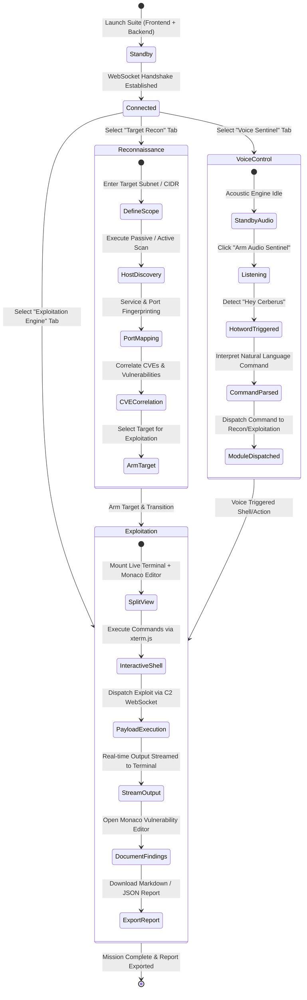

# Cyber-Cerberus: Operator User Flow & Interaction Journey

## 1. Overview

This document outlines the operational lifecycle, end-to-end user journeys, and state transitions of an operator using **Cyber-Cerberus**. The suite is structured to facilitate seamless workflows across reconnaissance, active exploitation, real-time command execution, voice dispatch, and vulnerability documentation.

---

## 2. Global Operator Journey



---

## 3. Step-by-Step Operator User Flows

### Flow 1: Suite Initialization & Verification

1. **System Boot**:
   - The operator starts the FastAPI server (`python3 main.py` or `uvicorn main:app --port 5000`) and the Next.js frontend (`npm run dev`).
2. **Accessing the Command Center**:
   - The operator accesses `http://localhost:3000` through a modern web browser.
3. **Telemetry & Connection Verification**:
   - The frontend's `useSocket` hook sends a handshake request to `http://localhost:5000/socket.io/`.
   - The operator inspects the top navbar:
     - **Connected State**: A pulsing green badge `🟢 Connected (Xms)` confirms that the WebSocket bridge is active with real-time round-trip latency.
     - **Disconnected State**: A red badge `🔴 Disconnected` displays if the backend is unreachable, allowing the operator to click **Ping** or **Reconnect** to re-attempt connection.

---

### Flow 2: Target Reconnaissance (`🔍 Target Recon`)

1. **Navigating to Recon Module**:
   - The operator clicks the **🔍 Target Recon** tab on the left sidebar.
2. **Reviewing Attack Surface Metrics**:
   - The top telemetry bar displays discovered hosts (active/down), exposed ports, and detected vulnerabilities categorized by severity (Critical, High, Medium).
3. **Inspecting the Target Matrix**:
   - The operator browses discovered assets in the **Target Asset Matrix**:
     - IP Address (`192.168.1.105`)
     - Operating System & Hostname (`app-srv-01 / Ubuntu 22.04`)
     - Open Ports & Services (`80, 443, 8080/tcp`)
     - Correlated CVEs (`CVE-2024-XXXX RCE`)
4. **Target Arming**:
   - The operator reviews targets flagged with `TARGET ARMED`, selecting them for transition to active exploitation.

---

### Flow 3: Exploitation Engine & Live Execution (`🎯 Exploitation Engine`)

This is the primary operational hub featuring a vertically split dual-pane interface:

```
+------------------------------------------------------------------------+
|                      CYBER-CERBERUS TOP NAVBAR                         |
| [Shield] CYBER-CERBERUS   | MODULE: EXPLOITATION | 🟢 Connected (12ms) |
+-------------------+----------------------------------------------------+
| SIDEBAR           | TOP PANE: LIVE STREAMING TERMINAL (xterm.js)       |
|                   | - ASCII Banner & Interactive Shell Prompt          |
| 🔍 Target Recon   | - Keystroke echo, command execution                |
| 🎯 Exploit Engine | - Clear buffer, session restart, live TTY stream   |
| 🎙️ Voice Sentinel |----------------------------------------------------|
|                   | BOTTOM PANE: VULNERABILITY REPORT VIEWER (Monaco)  |
| [Host Telemetry]  | - Dual Mode Switcher: [MARKDOWN] | [JSON]          |
| Backend: :5000    | - Preloaded Red Team Assessment Templates          |
| Protocol: WSS     | - Copy to clipboard & Export report actions        |
+-------------------+----------------------------------------------------+
```

#### Terminal Sub-Flow (Top Half):
1. **Interactive Command Entry**:
   - The operator clicks inside the **Live Streaming Terminal** container.
   - The terminal presents an interactive prompt: `cerberus@c2:~$`.
2. **Command Dispatch**:
   - The operator types operational commands:
     - `help`: Lists available built-in commands.
     - `status`: Displays engine status, active target scopes, and backend telemetry.
     - `recon`: Queries the status of reconnaissance scans.
     - `clear`: Clears the xterm buffer.
3. **Execution & Streaming**:
   - Keystrokes are transmitted via WebSocket `terminal_command` events to the FastAPI backend.
   - Output is streamed asynchronously back to the terminal buffer via `terminal_output` events without page refreshes.

#### Vulnerability Viewer Sub-Flow (Bottom Half):
1. **Report Selection**:
   - The operator views the preloaded vulnerability assessment report generated from the engagement.
2. **Format Switching**:
   - **Markdown Button**: Displays executive summary, severity matrix (CVSS 3.1), proof-of-concept curl commands, and remediation steps.
   - **JSON Button**: Displays machine-readable structured findings, target IP mappings, exploit status, and telemetry metadata.
3. **Exporting Documentation**:
   - **Copy**: One-click copy of the entire Markdown or JSON payload to clipboard.
   - **Export**: Generates a downloadable `.md` or `.json` file (`cyber_cerberus_report.md`) directly in the browser.

---

### Flow 4: Voice Sentinel Multi-Modal Control (`🎙️ Voice Sentinel`)

1. **Activating the Sentinel**:
   - The operator navigates to the **🎙️ Voice Sentinel** tab.
   - Clicks **Arm Audio Sentinel** to engage the acoustic listening engine.
2. **Visual Feedback**:
   - Dynamic animated audio waveform bars pulse with green/red neon glow, indicating real-time voice activity detection (VAD).
3. **Issuing Voice Commands**:
   - The operator speaks operational directives using the wake word:
     - *"Hey Cerberus, scan target subnet"* -> Dispatches automated scan to Recon module.
     - *"Hey Cerberus, status report"* -> Generates acoustic status summary.
     - *"Hey Cerberus, open terminal buffer"* -> Focuses active exploitation terminal.
4. **Audit Trail**:
   - The **Voice Event & Dispatch Log** records every audio utterance, timestamp, and resulting execution state.

---

## 4. Error Handling & Edge Cases

| Condition | Operator Experience | System Remediation |
| :--- | :--- | :--- |
| **Backend Offline / Crashed** | Navbar badge switches to `🔴 Disconnected`, terminal echoes `[local-echo] ... (backend offline)`. | Frontend attempts automatic reconnection every 2s for up to 10 attempts. |
| **High Network Latency** | Latency indicator updates (e.g., `(240ms)` in amber). | Heartbeat maintains keep-alive; terminal uses local echo buffering. |
| **Terminal Resize / Window Resize** | Terminal container dimensions shift. | `xterm-addon-fit` recalculates columns and rows via window resize listeners. |
| **Report Formatting Inconsistencies** | Syntax errors highlighted in Monaco. | Monaco built-in linter displays syntax diagnostics in real time. |
